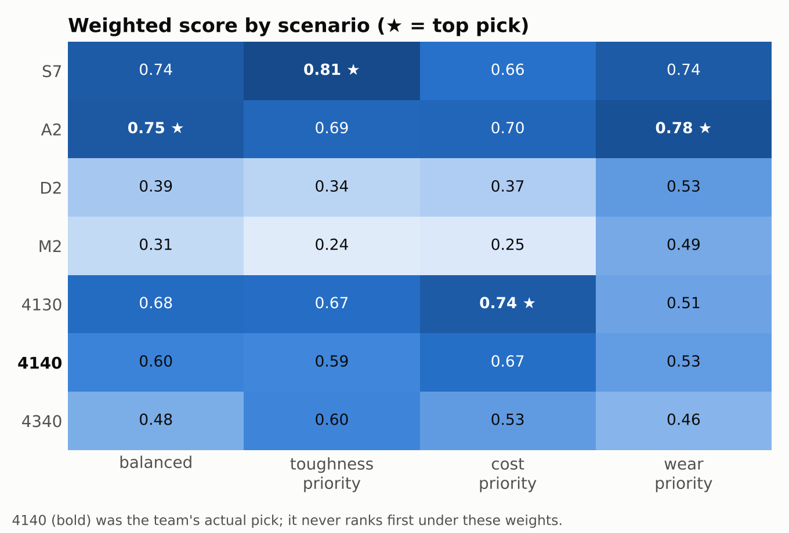
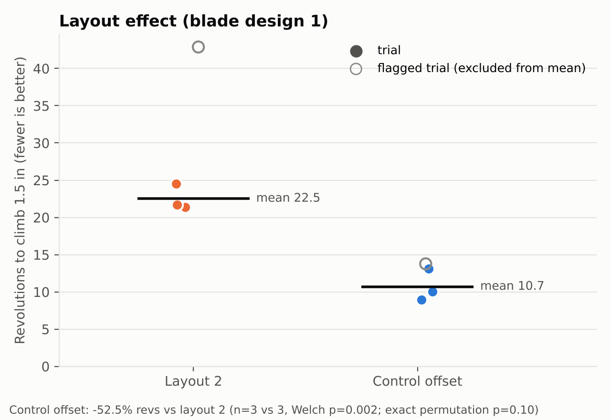
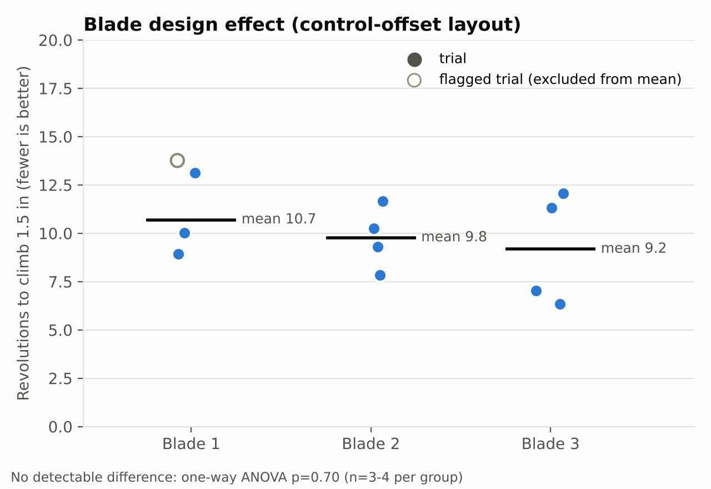

# Cutterhead Blade Material Trade Study — Boring Illini

A public write-up of the cutterhead blade work for **Boring Illini**, a student
tunnel-boring-machine team at UIUC. It answers two questions:

1. **Which steel should the cutterhead blades be made from?** This is a weighted
   multi-criteria trade study across seven candidate steels (`trade_study.py`).
2. **Does the cutterhead layout or the blade geometry change performance?**
   This is a statistical analysis of repeated physical trials (`layout_study.py`).

The two questions use different kinds of data, so they are analyzed
separately. For a one-page version, see **[SUMMARY.md](SUMMARY.md)**.

```bash
pip install -r requirements.txt
python trade_study.py     # material ranking under four weighting scenarios
python layout_study.py    # layout / blade-design statistics, incl. sensitivity checks
python make_figures.py    # regenerates figures/*.png from the CSVs
```

---

## 1. The problem

The cutterhead is the rotating face of the TBM. Its blades shear and scrape
soil, often conditioned clay. A blade material has to:

- stay **hard** enough to resist abrasive wear,
- be **tough** enough to survive shock loads from embedded rocks and stalls
  without chipping or cracking,
- be **machinable** by a student team with limited shop access and budget, and
- **heat-treat predictably**, without distortion or cracking that a small team
  can't detect or fix.

The team compared tool steels and alloy steels informally and chose **AISI
4140**. This repo rebuilds that decision as a transparent, reproducible model.
It also analyzes the physical trials the team ran on cutterhead layouts and
blade geometries.

## 2. Candidates

| Alloy | Family | Hardness (HRC) | Toughness (1–10) | Machinability (1–10) | Cost index | Austenitize (°C) |
|---|---|---|---|---|---|---|
| S7 | shock-resisting tool steel | 58 | 9 | 6.5* | 3.0 | 885 |
| A2 | air-hardening tool steel | 60* | 6 | 7.0 | 2.5 | 950 |
| D2 | high-C, high-Cr tool steel | 59 | 3 | 5.5 | 3.2 | 1015 |
| M2 | high-speed tool steel | 63* | 2 | 5.5 | 4.0 | 1215 |
| 4130 | Cr-Mo alloy steel | 22 | 7 | 7.0* | 1.0 | 870 |
| 4140 | Cr-Mo alloy steel | 32† | 6 | 6.3 | 1.2 | 845 |
| 4340 | Ni-Cr-Mo alloy steel | 35 | 8 | 5.0 | 1.8 | 830* |

`*` is an estimate and `†` is converted from Brinell. Every row in
[`data/steel_candidates.csv`](data/steel_candidates.csv) names its source and
says which values were published directly and which were estimated.

## 3. Criteria

| Criterion | How it enters the model |
|---|---|
| **Hardness** | Typical heat-treated HRC (higher is better) |
| **Toughness** | 1–10 score synthesized from datasheet Charpy, K_IC, and qualitative ratings (higher is better) |
| **Machinability** | 1–10 score from published machinability % where available (higher is better) |
| **Heat-treatment stability** | **Not scored.** See the note below. |
| **Cost** | Relative cost index (lower is better), used as the fourth scored criterion |

> **On heat-treatment stability.** The team weighed this criterion when it
> chose 4140, but the dataset has no defensible numeric measure of it, such as
> distortion, quench-crack susceptibility, or temper-embrittlement data. The
> CSV records austenitizing temperature, which is context, not a stability
> score, so it isn't used as one. The model scores **cost** as its fourth
> criterion instead. A missing criterion is one plausible reason the model
> disagrees with the team's choice (see Result).

## 4. Method

### 4a. Material trade study (`trade_study.py`)

1. **Normalize.** Each criterion is min-max scaled to 0–1 across the seven
   candidates, so Rockwell numbers and a cost index can be combined. Cost is
   inverted so that 1 always means "best."
2. **Weight.** Four named scenarios represent different priorities: `balanced`
   (equal weights), `toughness_priority`, `cost_priority`, and `wear_priority`.
3. **Score and rank.** `weighted_total = Σ normalized_value × weight`. The
   ranking is reported for every scenario, so you can see how sensitive the
   winner is to the weights.

### 4b. Layout and blade-geometry trials (`layout_study.py`)

The data is [`data/layout_trials.csv`](data/layout_trials.csv), extracted
from the team's `Cutterhead_Blade_Testing.xlsx`. The metric is **revolutions
for the cutterhead to climb 1.5 in through conditioned clay**, where fewer is
better. It is computed as `time_s / s_per_rev`. There are 2–4 trials per
configuration.

- **One variable changes per comparison.** Layout is compared with blade
  design held at 1, and blade design is compared with layout held at
  control-offset. The layout-2/blade-1 vs. control-offset/blade-3 pairing
  changes both variables, so it is confounded and isn't reported.
- **Flagged trials are reported, not silently dropped.** At collection time
  the team flagged a suspected muck-consistency error (`L2-B1-T1`), an
  inconsistent s/rev baseline (`CO-B1-T4`), and two `no_outside_flange` trials
  that stalled at about 1.0 in. The headline numbers exclude these trials, and
  the script shows every result both with and without them.
- **Tests.** Layout uses Welch's t-test. Blade design uses a one-way ANOVA
  followed by pairwise Welch tests. Because the samples are small, the script
  also reports a **sensitivity table** for each exclusion choice, a 95% CI, and
  **exact (distribution-free) tests**.

## 5. Results

### Material selection



| Scenario | Winner | 4140's rank (of 7) |
|---|---|---|
| balanced | A2 | 4 |
| toughness_priority | S7 | 5 |
| cost_priority | 4130 | 3 |
| wear_priority | A2 | 4 |

**The model does not reproduce the team's choice of 4140.** Under every
weighting, a tool steel (A2 or S7) or the cheaper, softer 4130 ranks higher.
I'm reporting that result rather than tuning weights until 4140 wins. There
are three plausible explanations:

1. **Heat-treatment stability isn't scored.** 4140 is forgiving to
   oil-quench and temper in a student shop. The tool steels need higher
   austenitizing temperatures (A2, D2, and M2 at 950–1215 °C), tighter
   atmosphere control, or both. If stability were scored, 4140's position
   would probably improve.
2. **Datasheet values aren't the team's stock.** The mill certs for the 4140
   the team actually bought may differ from these literature values.
3. **The real weights differed.** Availability, lead time, or advisor input
   may have dominated, and these four scenarios don't capture those factors.

### Layout effect: the headline result



| | Layout 2 | Control offset |
|---|---|---|
| n (flagged excluded) | 3 | 3 |
| Mean revs ± SD | 22.53 ± 1.71 | 10.70 ± 2.18 |

**The control-offset layout needed 52.5% fewer revolutions than layout 2**
(Welch's t = 7.40, df ≈ 3.8, **p = 0.0022**). The mean difference is 11.8
revs, with a 95% CI of [7.3, 16.4].

This **matches the stated result (≈52%, p ≈ 0.002, n = 3 vs 3).** I
recomputed it from the CSV, and it holds with these qualifications:

- **n = 3 vs 3 requires excluding one flagged trial from each group.** The
  sensitivity table shows the direction holds under every exclusion choice,
  but the size and p-value move:

  | Layout-2 trials | Control-offset trials | n | Change | Welch p | Exact Mann–Whitney p |
  |---|---|---|---|---|---|
  | all 4 | all 4 | 4 v 4 | −58.5% | 0.048 | 0.029 |
  | all 4 | excl. CO-B1-T4 | 4 v 3 | −61.3% | 0.042 | 0.057 |
  | excl. L2-B1-T1 | all 4 | 3 v 4 | −49.1% | 0.0008 | 0.057 |
  | **excl. L2-B1-T1** | **excl. CO-B1-T4** | **3 v 3** | **−52.5%** | **0.0022** | **0.100** |

- **p ≈ 0.002 assumes normality.** With 3 trials per group, there are only
  C(6,3) = 20 ways to split the data. An exact permutation or rank test
  therefore **cannot go below p = 0.10**, and these data hit that floor: every
  layout-2 trial needed more revolutions than every control-offset trial.
  The small p-value comes from the t-test's assumption that trials are
  normally distributed, which three points can't verify.
- Read this as strong directional evidence for the control-offset layout,
  with a large effect and complete separation between groups. It is not
  proof at p = 0.002. A replication with more trials per group would settle
  it.

### Blade design effect



Within the control-offset layout, blades 1, 2, and 3 averaged 10.7, 9.8, and
9.2 revs. **There is no detectable difference** (one-way ANOVA F = 0.37,
p = 0.70; all pairwise Welch p > 0.46). With n = 3–4 per group, the study
could only detect a large effect.

### Data-quality notes

- `no_outside_flange`: only 2 of 4 planned trials were run, and both stalled
  at about 1.0 in. They are excluded from all comparisons.
- `CO-B1-T4`'s flag note says its s/rev was logged as 0.66 against about 0.82
  for the rest of its group. The CSV value is 0.68, and the other three
  trials are 0.83–0.88. Check the original spreadsheet.
- The blade-2 and blade-3 trials ran at about 0.67 s/rev, while the blade-1
  trials ran at about 0.85 s/rev. Rotation speed therefore varies with blade
  design, which could mask or create a blade effect.

## 6. Next steps

- Get the mill cert for the team's 4140 and compare it with the literature
  values.
- Define a numeric heat-treatment-stability score, for example from
  quench-severity requirements and distortion or crack-sensitivity ratings,
  and add it as a fifth criterion.
- Re-run the layout comparison with 5 or more trials per group at a fixed
  rotation speed. That would let an exact test reach conventional
  significance, so the conclusion wouldn't depend on the normality
  assumption.

## Repo layout

```
data/steel_candidates.csv   material properties, with per-row sources
data/layout_trials.csv      repeated-trial cutterhead test data
trade_study.py              weighted decision matrix
layout_study.py             layout / blade statistics + sensitivity checks
make_figures.py             builds figures/*.png
SUMMARY.md                  one-page summary
```
