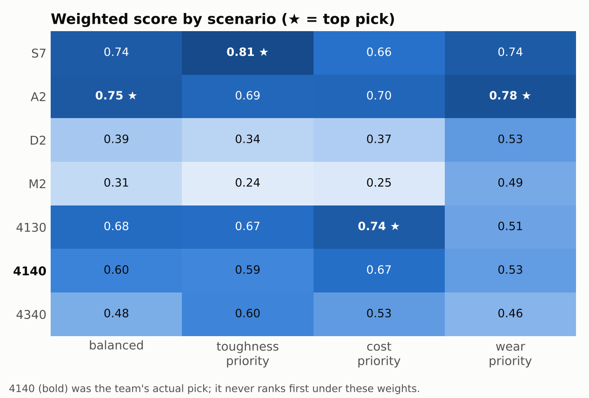
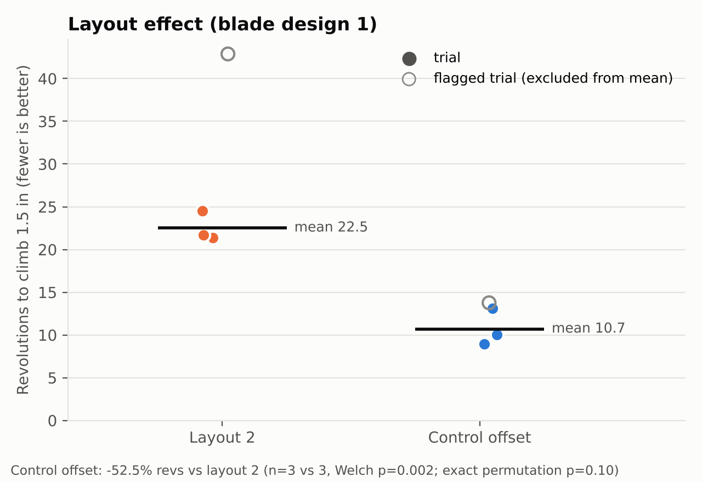

# Cutterhead Blade Trade Study: One-Page Summary

**Boring Illini (UIUC student tunnel-boring-machine team), cutterhead subteam**

### The question
Which steel should the cutterhead blades be made from, and does the
cutterhead layout or the blade geometry actually change digging performance?

### Material selection
- **Candidates:** four tool steels (S7, A2, D2, M2) and three alloy steels
  (4130, 4140, 4340).
- **Criteria:** hardness, toughness, machinability, and heat-treatment
  stability. The model scores the first three plus relative cost. Heat-treatment
  stability is discussed but not scored, because the data has no numeric
  measure for it.
- **Method:** a weighted decision matrix with cited datasheet values,
  normalized to 0–1 and ranked under four weighting scenarios.
- **Result:** the team built with **4140**. The model never ranks 4140 first;
  A2, S7, or 4130 wins depending on the weights. The most likely reason is that
  the model doesn't score heat-treatment stability, which favors 4140 in a
  student shop. The gap is reported, not tuned away.

### Layout testing
- **Test:** revolutions needed to climb 1.5 in through conditioned clay (fewer
  is better), with repeated trials per configuration.
- **Result:** the **control-offset layout needed 52.5% fewer revolutions than
  layout 2** (22.5 → 10.7 revs, n = 3 vs 3, Welch's t-test **p = 0.002**,
  95% CI on the difference 7.3–16.4 revs).
- **Caveats:**
  - Reaching n = 3 vs 3 means excluding one trial from each group that the team
    flagged at collection time. Including those trials gives a 49–61%
    reduction, with p between 0.0008 and 0.048.
  - An exact, distribution-free test can't go below p = 0.10 with three trials
    per group, so treat p = 0.002 as strong directional evidence that depends
    on a normality assumption, not as proof.
- **Blade geometry:** blades 1, 2, and 3 showed **no detectable difference**
  (ANOVA p = 0.70).

### Takeaway
The layout change is what the data supports. Blade geometry was
indistinguishable at this sample size. The material model is useful mainly
because it shows that the 4140 decision depended on a criterion (heat-treatment
practicality) that the datasheet numbers don't capture.

Code, data, and the full write-up: [README.md](README.md)
